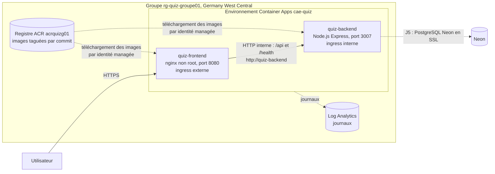

# Architecture cloud (J4)

## Choix techniques

| Élément | Choix | Pourquoi |
|---|---|---|
| Région | Germany West Central | France Central est refusée par l'abonnement Azure for Students |
| Environnement | mode WorkloadProfiles, profil Consumption | Le mode Express ne gère ni l'identité managée ni la découverte de services |
| Frontend | ingress externe, 0 à 1 réplique | Seule porte d'entrée publique, s'éteint sans visiteur pour réduire le coût |
| Backend | ingress interne, 1 réplique | Jamais exposé sur internet, joint par nginx avec le nom `quiz-backend` |
| HTTP interne | `--allow-insecure` sur le backend | nginx appelle le backend en HTTP ; le trafic reste dans l'environnement, le public passe en HTTPS |
| Accès au registre | identité managée système | Aucun mot de passe de registre stocké |
| Secrets | secrets Container Apps et `secretref` | JWT, mot de passe admin et clé Resend jamais écrits dans le code ni dans Git |
| Mise à jour | `scripts/deploy.sh` | Construit, envoie et déploie l'image taguée par le commit, ce qui crée une nouvelle révision |

## Problèmes rencontrés

- Le premier environnement a été créé en mode Express (préversion) : erreur `ExpressRegistrySystemIdentityNotSupported`. Il a été supprimé et recréé avec `--environment-mode WorkloadProfiles`.
- Juste après la suppression, Azure refusait un nouvel environnement (`MaxNumberOfEnvironmentsInSubExceeded`). Après quelques minutes d'attente, la création a réussi.
- Sans l'en-tête `Host $proxy_host` dans nginx, Container Apps ne sait pas vers quelle appli router la requête : la ligne a été ajoutée dans `nginx/default.conf.template`.