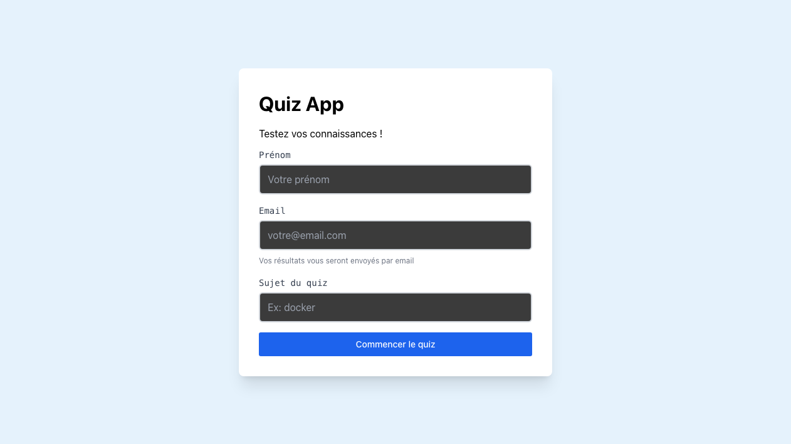
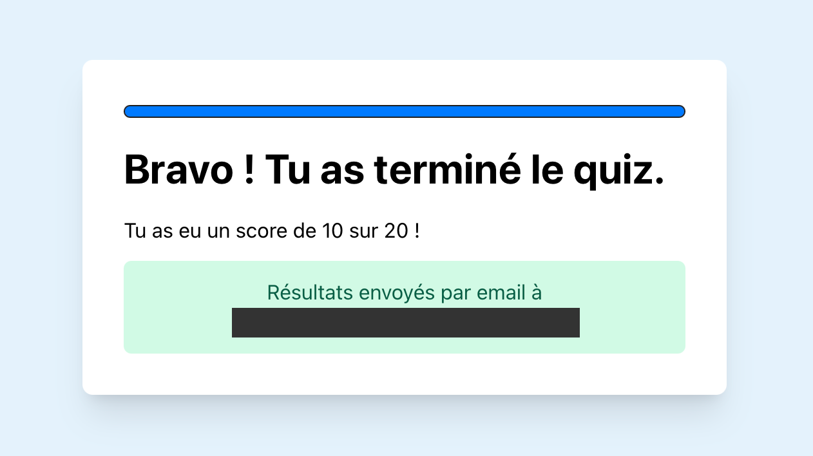
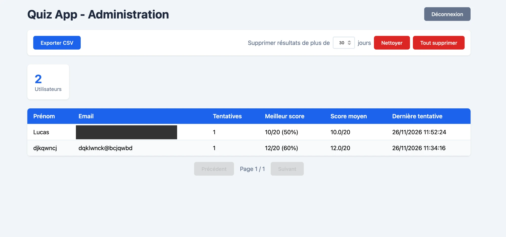
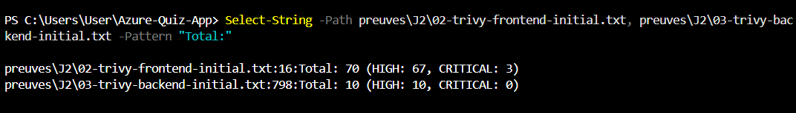
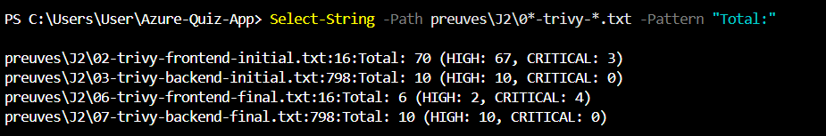
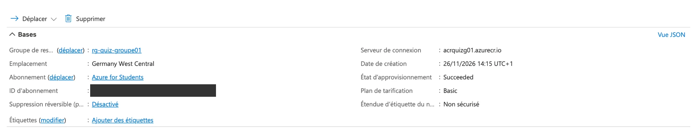
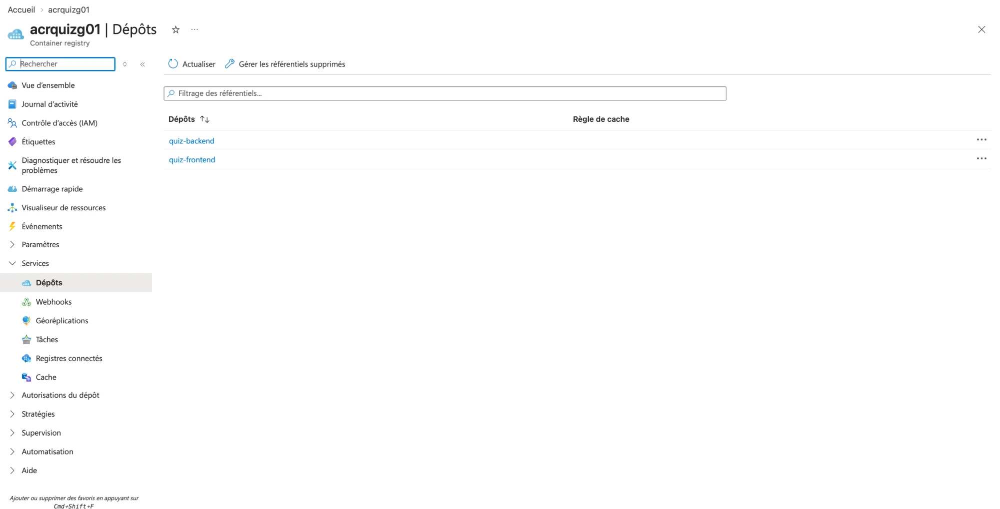
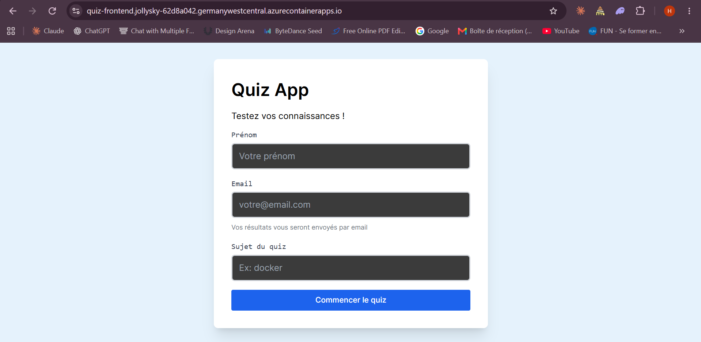
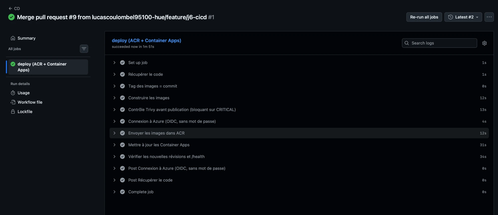

# Quiz App — Procédure pas à pas, de Docker à Azure

**Groupe 01** · M1 Containers · Dépôt : https://github.com/lucascoulombel95100-hue/Azure-Quiz-App · Mis à jour le 26/11/2026

**Site en ligne :** https://quiz-frontend.jollysky-62d8a042.germanywestcentral.azurecontainerapps.io

| Jalon | Sujet | État |
| --- | --- | --- |
| J0 | Vérifier l'abonnement Azure | ✅ Fait |
| J1 | Faire tourner l'app avec Docker | ✅ Fait |
| J2 | Sécuriser les images (Trivy) | ✅ Fait |
| J3 | Envoyer les images sur Azure (ACR) | ✅ Fait |
| J4 | Lancer l'app dans Azure Container Apps | ✅ Fait |
| J5 | Base PostgreSQL dans le cloud (Neon) | ✅ Fait (preuves en ligne à compléter) |
| J6 | CI/CD avec GitHub Actions | ✅ CI et CD en place (preuve du blocage à faire) |

## Le projet en bref

Quiz App a 3 parties :

- le **frontend** : le site (HTML/JS), servi par nginx ;
- le **backend** : l'API en Node.js ;
- la **base PostgreSQL** : les utilisateurs et les résultats.

Notre travail : mettre chaque partie dans un conteneur Docker, sécuriser les images, les déployer sur Azure, puis automatiser les livraisons. On ne touche pas au code de l'application.

**En local (J1) :**

```
Navigateur → http://localhost:8087
   │
   ▼
frontend (nginx)     seul port ouvert sur le Mac : 8087
   │  /api et /health
   ▼
backend (Node.js)    port 3007, pas ouvert
   │
   ▼
db (PostgreSQL)      port 5432, pas ouvert, données dans le volume pgdata
```

**Sur Azure (J3 à J6) :**

```
Navigateur → https://quiz-frontend…azurecontainerapps.io
   │
   ▼
quiz-frontend (Container App, accès public, nginx sans root, port 8080)
   │  /api et /health, par http://quiz-backend
   ▼
quiz-backend (Container App, accès interne seulement, port 3007)
   │  connexion chiffrée (TLS)
   ▼
PostgreSQL Neon (base externe, Francfort)

Images : registre ACR acrquizg01 (Germany West Central), lues par identité managée
Livraison : GitHub Actions → Trivy → ACR → Container Apps (connexion OIDC, sans mot de passe)
```

Le schéma détaillé de Hameem est dans `docs-groupe/architecture-cloud.md`.

---

# Partie 1 — Préparer le poste et Azure (J0)

## Étape 1 — Récupérer le projet dans VS Code

Sur GitHub, on fait un **Fork** du dépôt du prof, puis on clone **notre fork** (c'est là qu'on a le droit d'écrire) :

```bash
git clone https://github.com/lucascoulombel95100-hue/Azure-Quiz-App.git eval-quiz-app
cd eval-quiz-app
git remote add upstream https://github.com/franklin-tutorials/eval-quiz-app.git
```

`upstream` garde un lien vers le dépôt du prof, pour récupérer ses mises à jour.

## Étape 2 — Se connecter à Azure

```bash
az login
```

Une page web s'ouvre, on se connecte avec le compte de l'école. Ensuite, le terminal affiche la liste des abonnements : on tape le **numéro** de l'abonnement du groupe.

## Étape 3 — Vérifier l'abonnement et nos droits

```bash
az account list --refresh -o table
az account set --subscription ID_ABONNEMENT_DU_GROUPE
az account show -o table
az provider show --namespace Microsoft.App --query registrationState -o tsv
az provider show --namespace Microsoft.OperationalInsights --query registrationState -o tsv
az provider show --namespace Microsoft.ContainerRegistry --query registrationState -o tsv
az group show -n rg-quiz-groupe01 -o table
az role assignment list -g rg-quiz-groupe01 -o table
```

- `az account list --refresh` : liste nos abonnements.
- `az account set` : choisit l'abonnement du groupe. Son Id est dans la colonne `SubscriptionId` de la commande d'avant.
- `az provider show` : vérifie que les services dont on a besoin sont activés (Container Apps, les logs, le registre d'images). Réponse attendue : `Registered`.
- `az group show` et `az role assignment list` : vérifient notre groupe de ressources et nos droits.

**Résultat :**

- Abonnement **Azure for Students**, actif, **100 €** de crédits
- Groupe de ressources `rg-quiz-groupe01`, rôle **Contributor**
- Le groupe est en France Central, mais nos ressources iront en **Germany West Central** : l'abonnement refuse France Central (voir étape 21)

---

# Partie 2 — Conteneuriser l'application (J1)

## Étape 4 — Créer une branche

```bash
git checkout -b feature/j1-conteneurisation
```

On ne modifie jamais `main` directement : tout passe par une Pull Request.

## Étape 5 — Écrire les fichiers Docker

| Fichier | À quoi il sert |
| --- | --- |
| `backend/Dockerfile` | Fabrique l'image du backend |
| `Dockerfile` | Fabrique l'image du frontend |
| `.dockerignore` et `backend/.dockerignore` | Ce qu'on ne met pas dans l'image (`node_modules`, `.env`…) |
| `nginx/default.conf.template` | Dit à nginx d'envoyer `/api` vers le backend |
| `docker-compose.yml` | Lance les 3 conteneurs ensemble |

> Ces fichiers sont ceux de J1. Ils ont été modifiés en J2 (étapes 14 et 15).

### `backend/Dockerfile`

```dockerfile
FROM node:22-alpine
WORKDIR /app
COPY package*.json ./
RUN npm ci --omit=dev && npm cache clean --force
COPY . .
USER node
EXPOSE 3007
CMD ["node", "server.js"]
```

| Ligne | Ce qu'elle fait |
| --- | --- |
| `FROM node:22-alpine` | Part d'une image Node légère |
| `WORKDIR /app` | Dossier de travail dans le conteneur |
| `COPY package*.json ./` | Copie d'abord la liste des dépendances |
| `RUN npm ci --omit=dev && npm cache clean --force` | Installe les dépendances, sans celles de dev |
| `COPY . .` | Copie le code. Comme il vient après, Docker garde les dépendances en cache si on change juste le code |
| `USER node` | Ne tourne pas en root (plus sûr) |
| `EXPOSE 3007` | Le backend écoute sur le port 3007 |
| `CMD ["node", "server.js"]` | Commande lancée au démarrage |

### `Dockerfile` (frontend)

```dockerfile
FROM node:22-alpine AS build
WORKDIR /app
COPY package*.json ./
RUN npm ci
COPY . .
RUN npm run build

FROM nginx:1.27-alpine
COPY nginx/default.conf.template /etc/nginx/templates/default.conf.template
COPY --from=build /app/dist /usr/share/nginx/html
ENV BACKEND_HOST=backend:3007
EXPOSE 80
```

Il se fait en 2 étapes :

1. **`build`** : une image Node installe les dépendances et construit le site (`npm run build`). Le résultat sort dans `dist/`.
2. **nginx** : on copie juste `dist/` et la config nginx. Node n'est pas dans l'image finale, donc elle est plus légère.

`BACKEND_HOST` donne à nginx l'adresse du backend. En local c'est `backend:3007`. Sur Azure, on la change sans refaire l'image.

### `docker-compose.yml`

```yaml
services:
  db:
    image: postgres:16-alpine
    environment:
      POSTGRES_USER: ${POSTGRES_USER}
      POSTGRES_PASSWORD: ${POSTGRES_PASSWORD}
      POSTGRES_DB: ${POSTGRES_DB}
    volumes:
      - pgdata:/var/lib/postgresql/data
      - ./database/init.sql:/docker-entrypoint-initdb.d/init.sql:ro
    healthcheck:
      test: ["CMD-SHELL", "pg_isready -U ${POSTGRES_USER} -d ${POSTGRES_DB}"]
      interval: 5s
      retries: 10

  backend:
    build: ./backend
    environment:
      DATABASE_URL: postgres://${POSTGRES_USER}:${POSTGRES_PASSWORD}@db:5432/${POSTGRES_DB}
      RESEND_API_KEY: ${RESEND_API_KEY}
      FROM_EMAIL: ${FROM_EMAIL}
      ADMIN_USERNAME: ${ADMIN_USERNAME}
      ADMIN_PASSWORD: ${ADMIN_PASSWORD}
      JWT_SECRET: ${JWT_SECRET}
    depends_on:
      db:
        condition: service_healthy

  frontend:
    build: .
    ports:
      - "8087:80"
    depends_on:
      - backend

volumes:
  pgdata:
```

- **`db`** : PostgreSQL. Le volume `pgdata` garde les données. `init.sql` crée les tables au premier démarrage. Le `healthcheck` vérifie que la base répond (`pg_isready`).
- **`backend`** : dans `DATABASE_URL`, `db` est le nom du service : Docker sait trouver le conteneur avec ce nom. Il attend que la base soit prête (`service_healthy`) avant de démarrer.
- **`frontend`** : c'est le seul qui a `ports` : `8087:80` veut dire port 8087 du Mac → port 80 du conteneur.
- Les `${...}` sont lus dans le fichier `.env` : aucun mot de passe n'est écrit dans le compose.

## Étape 6 — Créer le fichier `.env`

```bash
cp .env.example .env
```

On remplace les mots de passe dans `.env`. Ce fichier contient les secrets : il n'est **jamais** envoyé sur GitHub (il est dans `.gitignore`).

## Étape 7 — Construire les images

```bash
docker compose build
docker images | grep eval-quiz-app
```

**Résultat :** 2 images, backend (263 Mo) et frontend (76 Mo). La base utilise l'image officielle `postgres:16-alpine`, pas besoin de la construire.

## Étape 8 — Lancer les conteneurs

```bash
docker compose up -d
docker compose ps --format "table {{.Service}}\t{{.Status}}\t{{.Ports}}"
```

L'option `-d` fait tourner les conteneurs en arrière-plan.

**Résultat :**

```
SERVICE    STATUS                   PORTS
backend    Up 6 minutes             3007/tcp
db         Up 6 minutes (healthy)   5432/tcp
frontend   Up 6 minutes             0.0.0.0:8087->80/tcp
```

Les 3 conteneurs tournent, la base est **healthy**, et seul le frontend a un port ouvert sur le Mac.

## Étape 9 — Vérifier que le frontend parle au backend

```bash
curl -i http://localhost:8087/health
docker compose logs backend
```

**Résultat :**

```
HTTP/1.1 200 OK
Server: nginx/1.27.5
X-Powered-By: Express
{"status":"ok"}
```

La requête arrive sur nginx (`Server: nginx`), qui l'envoie au backend (`X-Powered-By: Express`). Les logs affichent `Server running on port 3007`.

## Étape 10 — Tester l'application

On ouvre http://localhost:8087, on fait un quiz, puis on ouvre http://localhost:8087/gestion-quiz et on se connecte avec le compte admin du `.env`.

**Page d'accueil :**



**Fin du quiz :** le score est enregistré dans la base.



**Page admin :** les résultats sont bien dans PostgreSQL.



> Les adresses email personnelles sont masquées sur les captures.

## Étape 11 — Vérifier que les données restent

```bash
docker compose exec db psql -U quiz_user -d quiz_db -c "SELECT id, score, total_questions, completed_at FROM quiz_results;"
docker compose down
docker compose up -d
docker compose exec db psql -U quiz_user -d quiz_db -c "SELECT id, score, total_questions, completed_at FROM quiz_results;"
```

**Résultat, identique avant et après :**

```
 id | score | total_questions |       completed_at
----+-------+-----------------+---------------------------
  1 |    12 |              20 | 2026-11-26 10:34:16.06697
```

**Pourquoi :** `docker compose down` supprime les conteneurs, mais **pas le volume** `pgdata` où PostgreSQL range ses données. Avec `docker compose down -v`, on aurait tout perdu. Sur la page admin, ce résultat de 12/20 est toujours là.

## Étape 12 — Envoyer sur GitHub

```bash
git add Dockerfile backend/Dockerfile .dockerignore backend/.dockerignore docker-compose.yml nginx/ preuves/J1
git commit -m "J1 : conteneurisation locale"
git push -u origin feature/j1-conteneurisation
```

Puis sur GitHub : Pull Request de `feature/j1-conteneurisation` vers `main` **de notre fork**.

---

# Partie 3 — Sécuriser les images (J2)

But : trouver les failles connues dans nos images avec **Trivy**, les corriger, puis refaire le scan pour prouver que c'est mieux. Trivy compare les logiciels installés dans l'image avec une liste de failles connues (les CVE).

## Étape 13 — Scanner les images de départ

On garde d'abord une copie des images de J1, avec le tag `initial` :

```bash
docker build -t quiz-frontend:initial .
docker build -t quiz-backend:initial ./backend
```

Puis on les scanne. On lance Trivy dans un conteneur : pas besoin de l'installer, et la version est fixée (0.70.0).

```bash
mkdir -p preuves/J2
docker run --rm -v /var/run/docker.sock:/var/run/docker.sock aquasec/trivy:0.70.0 image --severity HIGH,CRITICAL quiz-frontend:initial > preuves/J2/02-trivy-frontend-initial.txt
docker run --rm -v /var/run/docker.sock:/var/run/docker.sock aquasec/trivy:0.70.0 image --severity HIGH,CRITICAL quiz-backend:initial > preuves/J2/03-trivy-backend-initial.txt
grep "Total:" preuves/J2/0*-trivy-*.txt
```

- L'option `-v /var/run/docker.sock:...` permet à Trivy de voir les images de notre machine.
- L'option `--severity HIGH,CRITICAL` garde seulement les failles graves.
- `grep "Total:"` affiche juste le nombre de failles de chaque scan (sous Windows : `Select-String`).

**Résultat :**



| Image | Failles | Où ? |
| --- | --- | --- |
| frontend | **70** (67 HIGH, 3 CRITICAL) | Dans le système de l'image (Alpine 3.21.3) |
| backend | **10** (10 HIGH) | Toutes dans **npm** (`brace-expansion`, `ip-address`, `pacote`, `picomatch`, `sigstore`), pas dans notre appli |

## Étape 14 — Corriger le frontend

```dockerfile
FROM node:22-alpine AS build
WORKDIR /app
COPY package*.json ./
RUN npm ci
COPY . .
RUN npm run build

FROM nginxinc/nginx-unprivileged:mainline-alpine
USER root
RUN apk upgrade --no-cache
USER 101
COPY nginx/default.conf.template /etc/nginx/templates/default.conf.template
COPY --from=build /app/dist /usr/share/nginx/html
ENV BACKEND_HOST=backend:3007
EXPOSE 8080
```

| Changement | Pourquoi |
| --- | --- |
| `nginx:1.27-alpine` → `nginxinc/nginx-unprivileged:mainline-alpine` | Image récente (Alpine 3.24) : les 70 failles disparaissent. « unprivileged » veut dire que nginx tourne **sans root** |
| `mainline` et pas `stable` | On a d'abord essayé `stable-alpine` : il restait **4 CRITICAL** dans nginx (capture ci-dessous) |
| `USER root` → `apk upgrade` → `USER 101` | On repasse root juste le temps d'installer les derniers correctifs, puis on revient à l'utilisateur nginx (101) |
| `EXPOSE 8080` | Cette image écoute sur 8080 au lieu de 80 : pas besoin d'être root pour ce port |

On change aussi le port dans `nginx/default.conf.template` (`listen 8080;`) et dans `docker-compose.yml` (`"8087:8080"`). L'adresse reste http://localhost:8087.

**Essai intermédiaire avec `stable-alpine` :** le frontend avait encore 4 CRITICAL, et npm n'était pas encore retiré du backend.



## Étape 15 — Corriger le backend

```dockerfile
# Étape 1 : installer les dépendances
FROM node:22-alpine AS deps
WORKDIR /app
COPY package.json package-lock.json ./
RUN npm ci --omit=dev

# Étape 2 : image finale, sans npm
FROM node:22-alpine
ENV NODE_ENV=production
RUN apk upgrade --no-cache \
 && rm -rf /usr/local/lib/node_modules/npm /usr/local/bin/npm /usr/local/bin/npx \
           /usr/local/lib/node_modules/corepack /usr/local/bin/corepack \
           /opt/yarn* /usr/local/bin/yarn /usr/local/bin/yarnpkg
WORKDIR /app
COPY --from=deps /app/node_modules ./node_modules
COPY package.json server.js ./
USER node
EXPOSE 3007
CMD ["node", "server.js"]
```

| Changement | Pourquoi |
| --- | --- |
| 2 étapes : `deps`, puis l'image finale | npm sert juste à installer les dépendances. L'image finale récupère seulement `node_modules` |
| `rm -rf .../npm .../corepack .../yarn` | Les 10 failles étaient dans npm. L'appli n'en a pas besoin pour tourner, donc on le supprime |
| `apk upgrade` | Installe les derniers correctifs Alpine |
| `COPY package.json server.js` au lieu de `COPY . .` | Seuls les fichiers utiles entrent dans l'image |
| `ENV NODE_ENV=production` | Lance Node en mode production |

Le Dockerfile utilise `package-lock.json` : on l'a ajouté au dépôt (`cd backend && npm install`), sinon le build échouait sur un autre PC.

## Étape 16 — Reconstruire et refaire le scan

```bash
docker compose up -d --build
docker run --rm -v /var/run/docker.sock:/var/run/docker.sock aquasec/trivy:0.70.0 image --severity HIGH,CRITICAL azure-quiz-app-frontend:latest > preuves/J2/06-trivy-frontend-final.txt
docker run --rm -v /var/run/docker.sock:/var/run/docker.sock aquasec/trivy:0.70.0 image --severity HIGH,CRITICAL azure-quiz-app-backend:latest > preuves/J2/07-trivy-backend-final.txt
cat preuves/J2/06-trivy-frontend-final.txt
grep -cE "HIGH|CRITICAL" preuves/J2/07-trivy-backend-final.txt
```

Le nom des images dépend du nom du dossier du projet : on le vérifie avec `docker images`.

**Résultat :** **0 faille** HIGH ou CRITICAL dans les deux images. La dernière commande répond `0`.

```
┌────────────────────────────────────────────────┬────────┬─────────────────┬─────────┐
│                     Target                     │  Type  │ Vulnerabilities │ Secrets │
├────────────────────────────────────────────────┼────────┼─────────────────┼─────────┤
│ azure-quiz-app-frontend:latest (alpine 3.24.2) │ alpine │        0        │    -    │
└────────────────────────────────────────────────┴────────┴─────────────────┴─────────┘
```

Quand il n'y a aucune faille, Trivy n'écrit pas de ligne `Total:` : c'est normal.

## Étape 17 — Vérifier que tout marche encore

```bash
docker compose exec frontend whoami
docker compose exec backend whoami
curl -i http://localhost:8087/health
docker images
```

**Résultat :**

- frontend → `nginx`, backend → `node` : aucun conteneur ne tourne en root.
- `/health` répond toujours `200 OK` : l'appli marche après les corrections.
- Tailles : frontend 73,7 → 111 Mo, backend 268 → 273 Mo.

**Pourquoi la taille n'a pas baissé :** `apk upgrade` ajoute une couche à l'image. Et quand on supprime npm dans une couche du dessus, il est caché, mais il reste dans la couche du dessous. Le gain est sur la sécurité, pas sur la taille.

## Étape 18 — Envoyer sur GitHub

```bash
git checkout -b feature/j2-securite
git add Dockerfile backend/Dockerfile backend/package-lock.json docker-compose.yml nginx/default.conf.template docs-groupe/rapport-securite.md preuves/J2
git commit -m "J2 : sécurisation des images, scans Trivy avant/après et rapport"
git push -u origin feature/j2-securite
```

Puis Pull Request de `feature/j2-securite` vers `main` (PR #4, fusionnée). Le rapport complet est dans `docs-groupe/rapport-securite.md`.

## Bilan J2

| Image | Avant | Après |
| --- | --- | --- |
| frontend | 3 CRITICAL, 67 HIGH | **0** |
| backend | 0 CRITICAL, 10 HIGH | **0** |

**Failles restantes :** on n'a pas traité les failles MEDIUM et LOW. `npm` signale 4 failles modérées dans les dépendances du backend : à surveiller. Le scan est refait automatiquement par la CI (J6).

---

# Partie 4 — Publier les images sur Azure (J3)

But : créer un **registre d'images** sur Azure avec Azure CLI, et y envoyer nos 2 images. Un registre (ACR, *Azure Container Registry*), c'est comme Docker Hub, mais privé et sur notre abonnement Azure. En J4, Azure va chercher les images dedans.

## Étape 19 — Créer une branche à jour

```bash
git checkout main
git pull
git checkout -b feature/j3-acr
```

`git pull` ne met à jour que la branche sur laquelle on est : il faut être sur `main` pour récupérer le travail fusionné.

## Étape 20 — Écrire les scripts

| Fichier | À quoi il sert |
| --- | --- |
| `scripts/deploy.sh` | Crée le registre s'il n'existe pas, construit les images et les envoie (puis, depuis J4, met à jour les Container Apps) |
| `scripts/destroy.sh` | Supprime le registre et ses images, après confirmation |
| `.gitattributes` | Garde les scripts au format Unix, même s'ils sont modifiés sous Windows |

Le cœur de `deploy.sh`, avec les valeurs remplacées :

```bash
az acr create -g rg-quiz-groupe01 -n acrquizg01 -l germanywestcentral --sku Basic
az acr login -n acrquizg01
docker build --platform linux/amd64 -t acrquizg01.azurecr.io/quiz-backend:c9b5dfa ./backend
docker build --platform linux/amd64 -t acrquizg01.azurecr.io/quiz-frontend:c9b5dfa .
docker push acrquizg01.azurecr.io/quiz-backend:c9b5dfa
docker push acrquizg01.azurecr.io/quiz-frontend:c9b5dfa
```

- `az acr create` crée le registre (Basic, le moins cher), seulement s'il n'existe pas encore.
- `az acr login` connecte Docker au registre.
- L'option `--platform linux/amd64` est nécessaire : Azure fait tourner les conteneurs en amd64, alors que notre Mac est en arm64.
- Le tag `c9b5dfa` est le **commit Git** (`git rev-parse --short HEAD`) : on sait exactement quel code est dans chaque image, ce que `latest` ne dit pas.
- Aucun secret dans les scripts. On peut changer une valeur sans toucher au script, par exemple `ACR_NAME=autrenom ./scripts/deploy.sh`.

## Étape 21 — Trouver une région autorisée

Le premier lancement a échoué :

```
(RequestDisallowedByAzure) Resource 'acrquizg01' was disallowed by Azure: This policy maintains a set of best available regions where your subscription can deploy resources.
```

Notre abonnement Azure for Students n'accepte que certaines régions, et France Central n'en fait pas partie. On a donc testé chaque région **à blanc** : Azure dit s'il accepterait la création, mais ne crée rien.

```bash
az deployment group validate -g rg-quiz-groupe01 --template-file acr-test.json --parameters location=germanywestcentral name=acrquizg01
```

`acr-test.json` est un petit modèle qui décrit juste un registre (son contenu est dans la preuve).

**Résultat :** sur 65 régions, 7 sont autorisées, dont Germany West Central, Switzerland North et Italy North. On a pris **Germany West Central** : elle est en Europe, et elle accepte aussi les logs et Container Apps dont on a besoin en J4. Preuve : `preuves/J3/00-regions-autorisees.txt`.

Le nom `acrquizgroupe01` était aussi déjà pris : un nom de registre est unique dans tout Azure. On l'a vérifié avec `az acr check-name`, puis pris `acrquizg01`.

## Étape 22 — Lancer le déploiement

```bash
./scripts/deploy.sh
```

**Résultat :** le registre est créé, et les 2 images sont envoyées avec le tag `c9b5dfa`, le commit de `main` avec J2.

## Étape 23 — Vérifier dans Azure

```bash
az acr show -n acrquizg01 --query "{Nom:name, Serveur:loginServer, SKU:sku.name, Region:location}" -o table
az acr repository show-tags -n acrquizg01 --repository quiz-frontend --detail --query "[].{Tag:name, Digest:digest, Date:createdTime}" -o table
az acr repository show-tags -n acrquizg01 --repository quiz-backend --detail --query "[].{Tag:name, Digest:digest, Date:createdTime}" -o table
```

**Résultat :**

```
Nom         Serveur                SKU    Region
----------  ---------------------  -----  ------------------
acrquizg01  acrquizg01.azurecr.io  Basic  germanywestcentral
```

| Image | Tag | Digest (début) |
| --- | --- | --- |
| `quiz-frontend` | `c9b5dfa` | `sha256:52c5c74a2b10…` |
| `quiz-backend` | `c9b5dfa` | `sha256:8204b841e54f…` |

Le **digest** est l'empreinte unique de l'image : si un seul octet change, il change aussi. Les digests complets sont dans `preuves/J3/`.

**Dans le portail Azure :** **Groupes de ressources** > `rg-quiz-groupe01` > `acrquizg01`.



Puis **Services** > **Dépôts** : nos 2 images.



> L'ID d'abonnement est masqué sur la capture.

## Étape 24 — Envoyer sur GitHub

```bash
git add scripts/deploy.sh scripts/destroy.sh .gitattributes preuves/J3
git commit -m "J3 : scripts Azure CLI, registre ACR et images"
git push -u origin feature/j3-acr
```

Puis Pull Request de `feature/j3-acr` vers `main`.

---

# Partie 5 — Lancer l'app dans Azure Container Apps (J4)

But : faire tourner nos 2 images sur Azure. Le frontend est public, le backend reste privé.

> Commandes reconstituées d'après la configuration en ligne (J4 réalisé par Hameem).

## Étape 25 — Créer l'environnement

L'environnement Container Apps est le « réseau commun » où vivent nos 2 applis.

```bash
az containerapp env create -g rg-quiz-groupe01 -n cae-quiz -l germanywestcentral --environment-mode WorkloadProfiles
```

Le mode par défaut (Express, en préversion) refusait l'identité managée (`ExpressRegistrySystemIdentityNotSupported`) : on a recréé l'environnement en mode `WorkloadProfiles`.

## Étape 26 — Créer le backend (privé)

```bash
az containerapp create -g rg-quiz-groupe01 -n quiz-backend --environment cae-quiz \
  --image acrquizg01.azurecr.io/quiz-backend:30f3e71 \
  --registry-server acrquizg01.azurecr.io --registry-identity system \
  --ingress internal --target-port 3007 --allow-insecure \
  --cpu 0.25 --memory 0.5Gi --min-replicas 1 --max-replicas 1 \
  --secrets jwt-secret="$JWT_SECRET" admin-password="$ADMIN_PASSWORD" resend-api-key="$RESEND_API_KEY" \
  --env-vars ADMIN_USERNAME=admin JWT_SECRET=secretref:jwt-secret ADMIN_PASSWORD=secretref:admin-password RESEND_API_KEY=secretref:resend-api-key
```

- `--ingress internal` : le backend n'est **pas** joignable depuis internet, seulement depuis l'environnement.
- `--allow-insecure` : nginx l'appelle en HTTP, mais ce trafic reste à l'intérieur d'Azure.
- `--registry-identity system` : l'appli lit les images dans ACR avec une **identité managée**, sans mot de passe.
- `--secrets` + `secretref:` : les secrets sont stockés dans Azure, jamais dans le code ni dans Git. Les valeurs viennent de variables du terminal.

## Étape 27 — Créer le frontend (public)

```bash
az containerapp create -g rg-quiz-groupe01 -n quiz-frontend --environment cae-quiz \
  --image acrquizg01.azurecr.io/quiz-frontend:30f3e71 \
  --registry-server acrquizg01.azurecr.io --registry-identity system \
  --ingress external --target-port 8080 \
  --cpu 0.25 --memory 0.5Gi --min-replicas 0 --max-replicas 1 \
  --env-vars BACKEND_HOST=quiz-backend
```

- `--ingress external` et `--target-port 8080` : le site est public, et nginx écoute sur 8080 depuis J2.
- `BACKEND_HOST=quiz-backend` : nginx envoie `/api` et `/health` vers l'appli `quiz-backend`.
- `--min-replicas 0` : le frontend s'éteint quand personne ne l'utilise, pour économiser les crédits.

Il a aussi fallu ajouter `proxy_set_header Host $proxy_host;` dans `nginx/default.conf.template` : sans ça, Azure ne sait pas vers quelle appli envoyer la requête.

## Étape 28 — Vérifier

```bash
az containerapp list -g rg-quiz-groupe01 --query "[].{Nom:name, Adresse:properties.configuration.ingress.fqdn}" -o table
az containerapp revision list -g rg-quiz-groupe01 -n quiz-backend -o table
az containerapp logs show -g rg-quiz-groupe01 -n quiz-backend --tail 20 --format text
curl -i https://quiz-frontend.jollysky-62d8a042.germanywestcentral.azurecontainerapps.io/health
```

**Résultat :**

- Les 2 applis tournent, révisions **Healthy**. Logs du backend : `Server running on port 3007`.
- `/health` en ligne : **HTTP 200** `{"status":"ok"}`, servi par nginx puis Express.
- Depuis internet, l'adresse du backend répond **404** : il est bien privé.
- `http://` redirige vers `https://`.



Le backend démarre même sans base de données : la connexion à PostgreSQL ne se fait qu'à la première requête. `/health` ne touche pas à la base.

---

# Partie 6 — Base PostgreSQL dans le cloud (J5)

But : le backend sur Azure utilise une vraie base PostgreSQL externe (**Neon**), avec une connexion chiffrée. La base locale reste dans Docker Compose.

⚠️ L'adresse Neon contient un mot de passe : on ne la met jamais dans Git, dans une capture, ni dans une IA.

## Étape 29 — Créer la base et garder son adresse

Sur https://console.neon.tech : projet `quiz-app`, **Postgres 16**, région **Francfort** (proche de nos Container Apps). On copie l'adresse de connexion (elle contient `sslmode=require`), puis on la garde dans le terminal sans l'afficher :

```bash
read -s "NEON_URL?Colle l'adresse Neon puis Entrée : "
export NEON_URL
```

## Étape 30 — Créer les tables

```bash
docker run --rm -i postgres:16-alpine psql "$NEON_URL" < database/init.sql
docker run --rm postgres:16-alpine psql "$NEON_URL" -c '\dt'
```

On utilise le `psql` de l'image Docker `postgres` : rien à installer.

**Résultat :** 3 fois `CREATE TABLE`, 2 fois `CREATE INDEX`, et les tables `users`, `quiz_results` et `answers`.

## Étape 31 — Prouver que la connexion est chiffrée

```bash
docker run --rm postgres:16-alpine psql "$NEON_URL" -c '\conninfo' | grep SSL
docker run --rm postgres:16-alpine psql "${NEON_URL/sslmode=require/sslmode=disable}" -c 'SELECT 1'
```

**Résultat :**

```
SSL connection (protocol: TLSv1.3, cipher: TLS_AES_256_GCM_SHA384, compression: off)
ERROR:  connection is insecure (try using `sslmode=require`)
```

La connexion est chiffrée en **TLS 1.3**, et Neon **refuse** une connexion non chiffrée.

Piège : `pg_stat_ssl` affichait `ssl = f`. C'est normal chez Neon : un intermédiaire (proxy) reçoit la connexion chiffrée, puis parle à la base en interne. `pg_stat_ssl` ne voit que ce dernier bout.

## Étape 32 — Tester le backend avec Neon, en local

```bash
docker run --rm -d --name backend-neon -p 3010:3007 -e DATABASE_URL="$NEON_URL" -e RESEND_API_KEY=re_test eval-quiz-app-backend
curl -s -X POST http://localhost:3010/api/users -H "Content-Type: application/json" -d '{"firstname":"TestNeon","email":"test@exemple.fr"}'
docker run --rm postgres:16-alpine psql "$NEON_URL" -c "SELECT id, firstname, created_at FROM users;"
docker stop backend-neon
```

**Résultat :** `{"id":1,"firstname":"TestNeon",…}`, et la ligne est bien dans Neon.

Piège : sans `RESEND_API_KEY`, le backend plante au démarrage (`Missing API key`). On donne une clé factice pour le test.

## Étape 33 — Brancher Neon sur le backend Azure

```bash
az containerapp secret set -g rg-quiz-groupe01 -n quiz-backend --secrets database-url="$NEON_URL"
az containerapp update -g rg-quiz-groupe01 -n quiz-backend --set-env-vars DATABASE_URL=secretref:database-url
```

L'adresse est stockée comme **secret** dans Azure. La 2e commande crée une nouvelle révision du backend, qui lit ce secret.

## Étape 34 — Corriger un bug trouvé grâce aux logs

**Symptôme :** un quiz fait en ligne n'apparaissait pas dans `/gestion-quiz`.

```bash
az containerapp logs show -g rg-quiz-groupe01 -n quiz-backend --tail 50 --format text
```

```
Error saving results: null value in column "user_answer" of relation "answers" violates not-null constraint
```

**Cause :** quand on ne valide pas une question en 30 s, le site envoie une réponse vide (`null`), mais la table l'interdisait (`user_answer TEXT NOT NULL`). Tout le résultat était annulé, alors que le site affichait quand même « Résultats envoyés ».

**Correctif :** autoriser une réponse vide, sans toucher au code de l'appli (PR #8) :

```bash
docker run --rm postgres:16-alpine psql "$NEON_URL" -c "ALTER TABLE answers ALTER COLUMN user_answer DROP NOT NULL;"
docker compose exec db psql -U quiz_user -d quiz_db -c "ALTER TABLE answers ALTER COLUMN user_answer DROP NOT NULL;"
```

Et dans `database/init.sql` : `user_answer TEXT,` au lieu de `user_answer TEXT NOT NULL,` (pour les futures bases).

---

# Partie 7 — CI/CD avec GitHub Actions (J6)

But : chaque modification passe par une Pull Request contrôlée, puis est déployée automatiquement après la fusion.

```
Branche → Pull Request → CI : build + Trivy (bloquant) → approbation → fusion dans main
       → CD : build + Trivy → envoi dans ACR (tag = commit) → mise à jour des Container Apps
```

## Étape 35 — La CI sur chaque Pull Request (`.github/workflows/ci.yml`)

| Étape du workflow | Ce qu'elle fait |
| --- | --- |
| Construire l'image | `docker build` du frontend et du backend, en parallèle |
| Rapport Trivy complet | Liste les failles HIGH et CRITICAL, rapport gardé dans GitHub |
| **Contrôle bloquant** | `trivy … --severity CRITICAL --exit-code 1` : une seule faille CRITICAL fait **échouer** le contrôle |

Les 2 contrôles s'appellent `build-scan (frontend)` et `build-scan (backend)`. La CI n'utilise aucun secret et ne déploie rien.

## Étape 36 — Le CD après la fusion (`.github/workflows/cd.yml`)

| Étape du workflow | Ce qu'elle fait |
| --- | --- |
| Tag = commit | Les 7 premiers caractères du commit, comme en J3 |
| Construire + Trivy | Refait le contrôle avant de publier |
| Connexion à Azure | **OIDC** : GitHub prouve à Azure que c'est notre dépôt et la branche `main`, **sans mot de passe** |
| Envoyer dans ACR | `docker push` des 2 images |
| Mettre à jour les Container Apps | `az containerapp update --image …` : crée une nouvelle révision |
| Vérifier | Affiche les révisions actives et teste `/health` |

## Étape 37 — Donner à GitHub l'accès à Azure, sans mot de passe

```bash
./scripts/setup-github-oidc.sh
```

Le script crée une identité `id-github-quiz`, autorise GitHub à l'utiliser **seulement depuis `main` de notre dépôt**, et lui donne le rôle Contributor **sur notre groupe de ressources uniquement**. Donner un rôle demande d'être Owner : c'est Hameem qui l'a lancé.

Dans GitHub, **Settings > Secrets and variables > Actions**, on crée 3 secrets : `AZURE_CLIENT_ID`, `AZURE_TENANT_ID` et `AZURE_SUBSCRIPTION_ID`. Ce sont des identifiants, pas des mots de passe.

## Étape 38 — Protéger `main`

Dans **Settings > Rules > Rulesets**, une règle **active** sur la branche par défaut :

- Pull Request obligatoire, avec 1 approbation ;
- contrôles obligatoires : `build-scan (frontend)` et `build-scan (backend)` ;
- suppression et force push interdits.

## Étape 39 — Premier déploiement automatique

La fusion de la PR #9 a lancé le CD. Premier essai : la connexion à Azure a échoué.

```
AADSTS700213: No matching federated identity record found for presented assertion subject
'repo:lucascoulombel95100-hue@277745155/Azure-Quiz-App@1472863465:ref:refs/heads/main'
```

**Cause :** GitHub ajoute maintenant les numéros du compte (`@277745155`) et du dépôt (`@1472863465`) dans l'identité qu'il présente. Notre autorisation Azure attendait l'ancien format.

**Correctif :**

```bash
az identity federated-credential update -g rg-quiz-groupe01 --identity-name id-github-quiz -n github-main --issuer https://token.actions.githubusercontent.com --subject "repo:lucascoulombel95100-hue@277745155/Azure-Quiz-App@1472863465:ref:refs/heads/main" --audiences api://AzureADTokenExchange
```

Puis **Re-run failed jobs** : le CD passe en 1 min 51.



**Résultat :** les 2 applis tournent sur les images **`e6498ec`** (le commit de la fusion) : révisions `quiz-frontend--0000003` et `quiz-backend--0000007`, **Healthy**, et `/health` répond `{"status":"ok"}`.

## Étape 40 — Prouver que Trivy bloque (à faire)

Sur une branche de test, on remet l'ancienne image du frontend, qui avait 3 CRITICAL en J2 :

```bash
git checkout -b test/trivy-bloquant origin/main
sed -i '' 's#FROM nginxinc/nginx-unprivileged:mainline-alpine#FROM nginx:1.27-alpine#' Dockerfile
sed -i '' '/RUN apk upgrade --no-cache/d' Dockerfile
git add Dockerfile
git commit -m "Test : image vulnérable pour vérifier le blocage"
git push -u origin test/trivy-bloquant
```

Il faut retirer aussi `apk upgrade` : sinon il met à jour l'ancienne image, les failles CRITICAL disparaissent et le contrôle reste vert (premier essai raté, PR #11).

On ouvre la PR : `build-scan (frontend)` doit être **rouge**, et la fusion **bloquée**. On fait la capture, puis on **ferme la PR sans fusionner**. Rien n'est envoyé dans ACR : la CI ne publie jamais.

---

# Partie 8 — La démo de la soutenance

On montre la chaîne complète **en partant de zéro**, juste après la diapo 5 (environ 6 minutes : CI ≈ 40 s, CD ≈ 2 min).

| Étape | Ce qu'on fait | Ce qu'on montre |
| --- | --- | --- |
| 1 | On remet **à la main** l'image `nginx:1.27-alpine` (Alpine 3.21) et on retire `apk upgrade`, puis PR | `build-scan (frontend)` **rouge** (failles CRITICAL), « Merging is blocked » |
| 2 | On remet le Dockerfile de `main` (image corrigée en J2), puis push | Les 2 contrôles **verts** |
| 3 | On modifie la 2e question, push, Hameem approuve, on fusionne | Le **CD** déploie, la nouvelle question est **en ligne** |

```bash
git checkout main
git pull
git checkout -b demo/live
```

**Étape 1 :** dans `Dockerfile`, `FROM nginxinc/nginx-unprivileged:mainline-alpine` devient `FROM nginx:1.27-alpine`, et on supprime `RUN apk upgrade --no-cache`.

```bash
git add Dockerfile
git commit -m "Démo : image nginx 1.27 (Alpine 3.21, vulnérable)"
git push -u origin demo/live
```

**Étape 2 :**

```bash
git checkout origin/main -- Dockerfile
git add Dockerfile
git commit -m "Démo : retour à l'image nginx non root à jour"
git push
```

**Étape 3 :** dans `questions_docker.js`, `"Quelle est la principale fonction d'un volume Docker ?"` devient `"À quoi sert principalement un volume Docker ?"`.

```bash
git add questions_docker.js
git commit -m "Démo : modification d'une question Docker"
git push
```

Après l'approbation de Hameem, la fusion et le CD, on vérifie sans jouer tout le quiz (les questions sont mélangées) :

```bash
./scripts/verifier-question.sh "À quoi sert principalement un volume Docker"
```

**Plan B :** la PR #11 (test Trivy, déjà rouge) et les captures de `preuves/J6`.

L'antisèche complète (préparation, phrases à dire, plan B) est dans `docs-groupe/demo-soutenance.md`.

---

## Problèmes rencontrés

| Problème | Solution |
| --- | --- |
| `az login` refusé (`AADSTS50076`, double authentification) | Relancer `az login` avec `--claims-challenge` |
| `az group show` : `ResourceGroupNotFound` | On était sur notre abonnement perso. `az account list --refresh`, puis `az account set` sur l'abonnement du groupe |
| Commande cassée par un commentaire `# ...` collé à la fin | Dans le terminal du Mac (zsh), ne pas coller de commentaire après une commande |
| `.dockerignore` qui ne marchait pas (séparé par des virgules) | Une entrée par ligne |
| Mauvaise ligne `COPY` dans le Dockerfile backend | `COPY package*.json ./`, puis `npm ci`, puis `COPY . .` |
| Build du backend cassé sur un autre PC (`package-lock.json` pas sur GitHub) | Ajouter `backend/package-lock.json` au dépôt, car `npm ci` en a besoin |
| `nginx-unprivileged:stable-alpine` : encore 4 CRITICAL | Prendre `mainline-alpine` |
| Les 10 failles du backend étaient dans npm | Supprimer npm de l'image finale, l'appli n'en a pas besoin |
| La taille des images n'a pas baissé | Normal : supprimer un fichier dans une couche du dessus ne l'efface pas de la couche du dessous |
| `git pull` ne récupérait pas J2 | `git pull` ne met à jour que la branche actuelle : `git checkout main`, puis `git pull` |
| `az acr create` refusé en France Central (`RequestDisallowedByAzure`) | L'abonnement n'autorise que certaines régions. On les a testées à blanc avec `az deployment group validate`, puis on a pris Germany West Central |
| Nom `acrquizgroupe01` déjà pris | Un nom de registre est unique dans tout Azure. On a vérifié avec `az acr check-name`, puis pris `acrquizg01` |
| Environnement Container Apps en mode Express : `ExpressRegistrySystemIdentityNotSupported` | Recréer l'environnement en mode `WorkloadProfiles` |
| `MaxNumberOfEnvironmentsInSubExceeded` juste après une suppression | Attendre quelques minutes que la suppression soit finie |
| Azure ne routait pas `/api` vers le backend | Ajouter `proxy_set_header Host $proxy_host;` dans la config nginx |
| `pg_stat_ssl` affichait `ssl = f` chez Neon | Normal : le proxy de Neon reçoit la connexion chiffrée. Preuve avec `\conninfo` et le refus de `sslmode=disable` |
| Le backend plantait sans `RESEND_API_KEY` | Toujours donner une clé, même factice en test |
| Un quiz fait en ligne n'apparaissait pas dans `/gestion-quiz` | Logs Azure : réponse vide refusée par la base. Correctif : `user_answer` accepte le vide (PR #8) |
| « Failed to add secret » dans GitHub | Recharger la page et recommencer |
| Connexion OIDC refusée (`AADSTS700213`) | GitHub présente maintenant les numéros du compte et du dépôt : mettre à jour l'autorisation dans Azure |

## Usage de l'IA

On a utilisé un assistant IA pour comprendre les consignes, relire nos fichiers, écrire une première version des scripts et des workflows, et nous aider à diagnostiquer les erreurs. On a tout vérifié en le lançant nous-mêmes : build, lancement, `/health`, persistance, scans Trivy, déploiement Azure, base Neon et CI/CD. On n'a jamais donné de mot de passe ni d'adresse de base à l'IA.

## Preuves

- **J1 :** `preuves/J1/` : sorties de commandes (`01` à `08`) et captures (`09` à `11`)
- **J2 :** `preuves/J2/` : scans Trivy (`00` à `07`), captures (`08` et `09`) et le rapport `docs-groupe/rapport-securite.md`
- **J3 :** `preuves/J3/` : sorties de commandes (`00` à `04`), captures du portail (`05` et `06`) et les scripts `scripts/deploy.sh` et `scripts/destroy.sh`
- **J4 :** `preuves/J4/` : environnement, applis, ingress, noms des secrets, révisions, logs, `/health`, capture du site, et `docs-groupe/architecture-cloud.md`
- **J5 :** `preuves/J5/` : création des tables, connexion chiffrée, refus sans chiffrement, inscription via le backend
- **J6 :** `preuves/J6/` : capture du CD réussi, liens des PR et des exécutions (à compléter), workflows `.github/workflows/` et `scripts/setup-github-oidc.sh`

## Ce qu'il reste à faire

- **Créer la règle qui protège `main`** (étape 38) : elle n'est pas encore active.
- Prouver le blocage Trivy (étape 40) et faire les captures CI, règle `main` et révisions.
- Répéter la démo une fois (`docs-groupe/demo-soutenance.md`).
- Finir les preuves J5 en ligne (quiz fait sur Azure, présent dans Neon, puis après un redémarrage).
- Compléter `deploy.sh` (création des applis) et `destroy.sh` (suppression des applis, de l'environnement et des logs).
- Ajouter la section « Usage de l'IA » au `README.md` et corriger la région dans `docs-groupe/verification-azure.md`.
